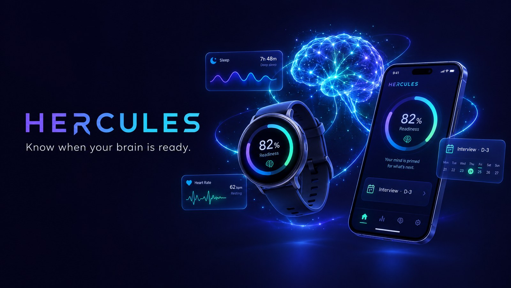

# Hercules

<p align="center"></p>



**Know when your brain is ready.** Hercules turns the signals your phone, watch and Health Connect already collect (sleep, heart rate variability, resting heart rate, skin temperature) plus a 3-minute reaction test, **Reaction Test**, into a **cognitive score (1–100)** for right now. It shows how much to trust that number, finds the time of day you tend to think best, and helps you prepare for important **Moments** in the next 7 days.

Android phone and Wear OS watch today (Kotlin Multiplatform), built so iOS and watchOS can follow with the same core logic. The full product and technical specification is [`docs/SPEC.md`](docs/SPEC.md).

---

# Part 1: Business process

## 1. The idea

High-stakes moments like a job interview, a negotiation, a pitch or an exam depend on focus, working memory and emotional control. Those depend heavily on how you slept and how recovered you are. Most people walk into those moments blind to their own condition.

Hercules answers three questions, in three menus:

| Question | Menu |
|---|---|
| *How ready am I to perform cognitively today?* | **Home**: score, level, confidence, why, one next step |
| *When do I tend to perform best?* | **Home**: Peak Cognitive Window, once enough reaction tests exist |
| *What can I do to prepare for an important Moment?* | **Moments**: up to 5 Moments, 7 days ahead, with preparation status |

**Setup** holds Health Connect, sensors and devices, score settings, baselines, About Hercules, reminders, data and legal pages.

## 2. Daily flow

1. **Data arrives on its own.** Health Connect is read when the app opens, every 5 minutes while it is open, and about every 15 minutes in the background (the watch records its sensors continuously and hands new readings to the phone within about 10 minutes; the phone also asks the watch for them every 15 minutes while it is connected). Every new batch of data recalculates the score. "Sync now" is optional. The Hercules watch is one more provider.
2. **A score appears from the first night or test.** One night of sleep or one Reaction Test is enough. The confidence line under the score says how far to trust it.
3. **Reaction Test (optional, any time, 3 minutes).** A reaction test modelled on the brief Psychomotor Vigilance Test (PVT-B), the standard measure of how tiredness slows attention. Herc pops up every 1 to 4 seconds; tap anywhere as fast as you can, 45 times (about 3 minutes). The screen shows how far you are ("3 of 45") and a timer that runs from Herc's appearance until your tap. Tapping before he appears is a false start. The test score compares your reaction speed with your usual (50 = usual) and shows your typical reaction time, slow reactions (500 ms+) and false starts. The first test is scored against a typical-player reference; from the fourth on, against your own usual; from five tests in 10 days, it is your rank among them. For 2 hours after a test, it makes up 60% of your score. Phone and watch keep separate baselines, since their screens respond differently.
4. **One next step.** The coach (`Coach.kt`) picks the single most useful action: play, prepare for a Moment, reflect on one, sleep earlier, or use your peak window. Phone and watch say the same thing.
5. **Sleep looks wrong?** Tap **Edit times** (or **Add sleep**) in the Sleep section. A corrected night is never overwritten by automatic detection.

**Meet Herc.** The mascot is the head of an adult male lion with a bright golden mane, designed with Higgsfield. **Each band has its own expression and eye colour**: fierce and focused with green eyes for Prime, calm and assured with lime eyes for Good, neutral with amber eyes for Fair, weary with orange eyes for Low, and worn down with red eyes for Drained. With no score yet he shows the Fair face with dim, narrowed eyes. He is the launcher icon on phone and watch, the animated splash, Home, the next-step card and the watch home. The base lion came from Recraft V4.1 (vector). Nano Banana Pro redrew it once per expression, and Ideogram Vector traced each one back to vector (`tools/mascot/lion/*.svg`). `tools/mascot/mascot.py` reads those files and writes `HercArt.kt` for both apps, plus the launcher, notification and animated-splash drawables.


**Reminders** (all optional, in Setup): morning score, Reaction Test, Moment prep (evening before and shortly ahead), bedtime, after a Moment, and focus start (off by default). **Only one device delivers each reminder:** the watch while it is worn, the phone otherwise.

**Home-screen widgets** (Setup › Home screen widgets): today's score with a Test Reaction button (2×2), today's steps, distance, resting pulse and sleep (2×2) and the last 10 days' scores (4×2). They update whenever the score does. On Xiaomi, allow *Home screen shortcuts* for Hercules first.

**Watch:** score with Herc, level and confidence, one next step, today's pulse, sleep and steps, Reaction Test (same rules as the phone), live pulse while the app is open, Sync now, upcoming Moments, and a tracking-status screen. A **watch-face complication** ("Hercules score") puts the score on the watch face; tapping it opens the app.

## 3. Reading the score

| Score | Level | What to do |
|---|---|---|
| 85–100 | **Prime** | Schedule the hardest things today |
| 70–84 | **Good** | Put important work in your peak window |
| 55–69 | **Fair** | Timing matters; use your best hours |
| 40–54 | **Low** | Postpone non-urgent big decisions if you can |
| 0–39 | **Drained** | Light tasks, recover, sleep early |

The score follows the day: highest soon after a good night, falling as the hours awake add up.

**Confidence** (0–100%) sits right under the score and is separate from the level. It adds up points for what is
behind the number: sleep from a watch 35 (phone estimate 15, usual sleep assumed 5), 8+ days of data 15 (5–7: 8),
HRV 8, resting heart rate 8 and skin temperature 8 (phone readings 4), a Reaction Test in the last 2 hours 19 (or 12
once Hercules is tuned to you), up to 7 for extra sensors, minus 5 for custom settings. **High** 75%+, **Medium**
50–74%, **Low** under 50%. Without sleep from a watch it can't reach High. It reads like *"Medium confidence · 61% ·
sleep: phone · 6 days of data"*, and below High it says what would raise it. **Why this score** opens from the score
and lists every part.

## 4. How the score is built (engine 5)

1. **Sleep model:** McCauley et al. 2013, a published model of attention lapses under sleep loss (values from the
   paper), runs through every night and nap of the last 10 days. Sleep debt builds over short nights; the body clock
   adds a daily rise and dip, moved to your usual wake time. Predicted lapses become **predicted alertness P**.
2. **Recovery M** (0.7–1): HRV, resting heart rate and skin temperature, each against your own last 10 days. Only
   readings worse than your usual lower the score (5% per standard deviation to start), by at most 30% in total.
   Optional: glucose, blood oxygen and breathing rate the same way.
3. **Reaction Test G**: if you took one in the last 2 hours, `score = 60% G + 40% P×M`; otherwise `score = P×M`.
4. **Tuned to you:** from 20 tests, Hercules fits your body-clock peak and how much each recovery signal matters for
   you.

- **Missing is never zero.** A missing signal is left out. Without a watch, sleep comes from Health Connect or,
  if you allow Usage Access, from your screen going off and your first unlock (never your apps). With no sleep on
  record, a recent test alone gives the score; otherwise your usual sleep window stands in (Low confidence).
- **One source per signal:** a wearable's reading beats a phone's, and each keeps its own baseline. Phone readings
  count half.
- **Score settings** (Setup): sliders for sleep influence, body clock, each recovery signal and the test's weight.
  Reset asks first. Any change lowers confidence by 5 points. Every stored score keeps the settings and engine
  version it was calculated with.
- **New data updates the score.** Every sync recalculates now and the previous 2 days (a past day is shown as it
  stood 6 hours after waking). Older days are never rewritten.
- **10 days only.** Everything older than 10 days is deleted from your devices, day by day. Only the tuning numbers
  and your settings are kept.
- **Today tiles** (steps, distance, resting and peak pulse, energy, floors) come from Health Connect's totals or the Hercules watch, whichever recorded more, and have their own **Sync** button. Steps, activity and light are shown, not scored.

## 5. Peak Cognitive Window

Each Reaction Test is filed under morning (0–4 h after waking), afternoon (4–8 h) or evening (8–16 h; still up late counts as evening). After 5 days, with at least 3 valid tests on 2 different days in every part of the day (current game version only), Hercules names the part of the day you perform best, or says there is no clear peak.

## 6. Moments (up to 7 days ahead)

Add a title, urgency (Normal or Critical), date and hour. Each Moment gets a **preparation status**, *On Track*, *Needs Attention* or *Insufficient Data*, from your recent readiness, sleep and recovery trends, activity, Reaction Test and whether the hour falls in your peak window. Recommendations depend on time left (5–7 days: build sleep regularity; 1–2 days: protect sleep; event day: current readiness and peak alignment). The time is treated as fixed: advice is about preparing, not rescheduling. Afterwards, one tap records how it went.

## 7. Sensors are your choice

**Setup → Sensors & data** is one page for everything that feeds the score: the Health Connect connection (permissions, background reading, Sync now), each signal with its source and state (permission needed, no recent data, live), the watch, and optional extras. Required Health Connect types: sleep, HRV, resting heart rate, steps, exercise. Optional extras: respiratory rate, skin temperature, SpO₂, heart rate, blood glucose. The watch sensor grid (heart rate, sleep, steps, calories, distance, floors) syncs both ways. Turning a sensor off removes its signal and lowers confidence; it never breaks the score.

## 8. Important limits

- Hercules is a **wellness estimate, not a medical or safety assessment**. It doesn't diagnose anything, and it must never decide whether you can drive or operate machinery.
- The model rests on published research (McCauley 2013), but the 1–100 scale and the settings are product hypotheses, not a clinical validation of this app. Caffeine, alcohol, medication and illness aren't modelled.
- Data stays on your devices. No backend, no account.

---

# Part 2: Technical

## Architecture

```
┌──────────── Wear OS watch (wear) ───────────┐        ┌────────────── Android phone (mobile) ──────────────┐
│ Health Services passive monitoring          │        │ Health Connect (auto read + background worker)     │
│                                             │        │ WatchSyncListenerService                           │
│  HR, steps, calories, distance, floors      │ batch  │  store samples → insights → readiness refresh      │
│  + user activity state (asleep/awake) ──────┼───────►│  → push WatchState back to the watch               │
│ Sync status: "Sent to phone · 2m ago"       │MessageC│ Compose UI: Today · Plan · Data(+Sensors)          │
│ Home: score, confidence, Reaction Test     │◄───────┤ DataClient: /hercules/state, /hercules/sensors/*   │
│ Sensors screen ◄──── /hercules/sensors ────►│DataCli.│ NoopRemoteSink → (future) HttpRemoteSink → backend │
└──────────────────────┬──────────────────────┘        └──────────────────────────┬─────────────────────────┘
                       └───────────── shared (Kotlin Multiplatform) ──────────────┘
      readiness/ Scoring · Assessment (Reaction Test) · Moments · Stats   cognitive/ CognitiveService · Coach
      SQLDelight DB · SensorConfig · SyncService/WireCodec · DemoData           (Android now, iOS/watchOS next)
```

All scoring and coaching logic is in `shared`, so the watch can compute a score on its own and an iOS/watchOS port reuses it unchanged.

## Modules

| Module | Contents |
|---|---|
| `shared/` | `readiness/` `Scoring.kt` (sleep model, recovery, calibration, confidence, settings), `Assessment.kt` (Reaction Test, peak window), `Moments.kt`, `HealthData.kt`, `Stats.kt` · `cognitive/` `CognitiveService` (orchestration) + `CognitiveStore`, `Coach`, `Nudges`, `ReadinessEngine` (sleep analysis) · `model/`, `insights/`, `data/` watch samples and daily summaries · `sensors/` · `sync/` batch sync + wire format · `demo/` synthetic data · `sqldelight/` schema |
| `wear/` | `health/` passive monitoring, sleep, sensor settings · `sync/` phone sink, periodic worker, `WatchStateSource` · `notify/` reminders · `ui/` home, Reaction Test, Moments (Wear Compose M3) |
| `mobile/` | `health/` Health Connect reader, background worker, phone light sensor · `sync/` receives watch batches · `notify/` reminders · `ui/` Home (`TodayScreen`, `CoachCards`), Moments (`PlanScreen`), Setup (`DataScreen`), `BeatTheClockScreen`, onboarding (`Journey`), legal |

## Sensors and what they're used for

| Sensor | Health Services source | Stored as | Used by |
|---|---|---|---|
| Heart rate | `HEART_RATE_BPM` (passive) | `heart_rate` | Resting HR → Cardiovascular (fallback when Health Connect has none) |
| Sleep | `UserActivityInfo` (`USER_ACTIVITY_ASLEEP / PASSIVE / EXERCISE`) | `activity_state` points (state changes) | `SleepAnalyzer`: main sleep in the window 18:00 the day before → 14:00, at least 60 min, wake-ups merged |
| Steps, calories, distance, floors | passive deltas | interval samples | Activity (on days the watch was worn), daily stats, records |

When the same signal comes from several places, the more reliable one wins (never summed): **sleep** from a wearable's staged night in Health Connect, then the Hercules watch; **HRV** from Health Connect (measured overnight by the wearable's app), then the watch; **resting heart rate and steps** from the Hercules watch on days it was worn, then Health Connect; **light** from the phone. Without the watch everything still works from Health Connect and the phone.

Only sensors that are **enabled** (`SensorConfig`) and **supported** by the watch are registered. The watch publishes a `SensorReport` (supported + active) so the phone shows the real state.

## Data and sync

- **Storage:** SQLDelight (`HerculesDatabase`). Watch data: `sample`, `workout_session`, `daily_summary`, `personal_record`, `sleep_night`. Readiness: `health_metric`, `sleep_session`, `exercise_session`, `light_sample`, `cognitive_session`, `cognitive_round`, `user_baseline`, `scoring_config`, `readiness_day` (JSON, with config and engine version), `peak_window`. Moments: `plan_event`, `prep_task_done`, `event_reflection`, `moment_snapshot`. Settings: `kv`.
- **Watch → phone:** every 15 minutes (WorkManager) and while the app is open. Batches go over `MessageClient` on `/hercules/sync/v1`. The phone acks the stored IDs, and only acked rows are marked synced. Sample IDs are deterministic, so retries are idempotent.
- **Phone → watch:** after each refresh the phone writes `WatchState` (score with confidence, next step, Moments) to DataClient `/hercules/state`. reaction tests sync both ways and are stored once per id. The watch uses it when it is less than 6 hours old and from today; otherwise it computes locally.
- **Sensor choice:** `/hercules/sensors/config`, written by either side; the newest `updatedMs` wins. The watch reports back on `/hercules/sensors/report`.
- **Backend (future):** the phone keeps everything queued (`synced = 0`). Swap `NoopRemoteSink` for an HTTP sink and set `SERVER_SYNC_ENABLED`. The wire contract is in `docs/contracts/sample-batch.v1.schema.json`.

## Build and test

Requirements: JDK 17+ (21 tested) and the Android SDK (compileSdk 36).

```bash
./gradlew :shared:testDebugUnitTest                  # unit tests: scoring, confidence, Reaction Test, peak, moments, coach, sync, DB
./gradlew :wear:assembleDebug :mobile:assembleDebug
./gradlew :wear:lintDebug :mobile:lintDebug
```

## Run

```bash
# Phone
adb -s <phone> install -r mobile/build/outputs/apk/debug/mobile-debug.apk
# Galaxy Watch: Developer options → ADB + Wireless debugging
adb connect <watch-ip>:<port>
adb -s <watch> install -r wear/build/outputs/apk/debug/wear-debug.apk
```

Both apps share the `applicationId` `com.hercules.app`, which the Wearable Data Layer requires.

**Try it without a watch (debug builds only):** load synthetic sleep, HRV, resting HR, steps, light and reaction tests plus sample Moments:

```bash
adb shell am start -n com.hercules.app/com.hercules.mobile.ui.MainActivity --ez demo true
```

**Setup → Score settings** also shows **Personal tuning**: tests counted toward the 20 needed, and the fitted values once tuned.

The watch has the same switch, so its UI can be checked on an unpaired Wear OS emulator (grant the sensor permissions first, or tap Allow):

```bash
adb -s <watch-serial> shell am start -n com.hercules.app/com.hercules.wear.ui.MainActivity --ez demo true
```

With no sleep and no recent test the score shows "Waiting on sleep or a Reaction Test"; a night or a test gives a score.

**Synthetic sensors on a Wear emulator:**

```bash
adb -s <watch> shell am broadcast -a "whs.USE_SYNTHETIC_PROVIDERS" com.google.android.wearable.healthservices
adb -s <watch> shell am broadcast -a "whs.synthetic.user.START_WALKING" com.google.android.wearable.healthservices
```

Logs: `adb logcat -s Hercules HerculesSync HerculesState HerculesPhoneSync`.

## Porting to iOS / watchOS

1. Install Xcode, then build the framework: `./gradlew -Phercules.apple=true :shared:linkDebugFrameworkWatchosSimulatorArm64` (targets `iosArm64`, `iosSimulatorArm64`, `watchosArm64`, `watchosSimulatorArm64`; framework `HerculesShared`).
2. **watchOS (SwiftUI):** feed HealthKit into `HerculesRepository.insertSamples`. Map `HKCategoryTypeIdentifier.sleepAnalysis` to `activity_state` samples, so `SleepAnalyzer` works as-is. Show `CognitiveService.watchState()`.
3. **iOS (SwiftUI or Compose Multiplatform):** WatchConnectivity replaces the Data Layer, HealthKit replaces Health Connect. Reuse `CognitiveService`, `Coach` and `SyncService`.
4. Consider SKIE so `suspend` and `Flow` look like Swift `async` and `AsyncSequence`.

## Design

The UI is designed as a **precision instrument**, not a wellness toy: matte black (`#05050E`), electric cyan (`#3FE0FF`) and indigo (`#6E6BFF`), hairline rules instead of card stacks, sharp 6 dp corners, small letter-spaced section labels, monospace readouts, and Material *Rounded* line icons (no emoji).

| Element | Where |
|---|---|
| Bezel dial: 100 ticks lit up to the score | Phone Today hero; watch home (follows the round screen edge) |
| Your day: last night's sleep, the three parts of the day, the peak window, *now*, today's Moments on one time axis | Phone Home |
| Countdown rail: Moments as stops on a vertical line | Phone Moments |
| Sensor tiles: lit = recording | Phone Setup |

**User journeys and illustrations** (generated with Higgsfield, GPT Image 2.5, in one blueprint style; `mobile/src/main/res/drawable-nodpi/ill_*.webp`):

| Journey step | Illustration |
|---|---|
| Welcome dialog 1 · One score | `ill_score`: head profile inside a precision dial |
| Welcome dialog 2 · No logging | `ill_sleep`: sleep wave flowing into a watch |
| Welcome dialog 3 · Test, then plan | `ill_checkin`: rings aligning |
| Empty Moments screen | `ill_plan`: seven ascending platforms to a diamond |

**Launch.** The system splash (Android 12+ API, backported) shows the mark on the brand black. On a cold start it hands off to an **animated splash**: Kling 3.0 via Higgsfield, converted to an animated WebP in `res/raw/splash_anim.webp` and played with `AnimatedImageDrawable`. Tap to skip.

| Asset | |
|---|---|
| `docs/images/hercules-icon.png` | Icon master (1024 px): **H** monogram, heartbeat crossbar, readiness gauge. Launcher, adaptive, round and monochrome icons in `mobile/` and `wear/` are generated from it |
| `docs/images/hercules-splash.jpg` | Static splash artwork |
| `docs/images/hercules-hero.jpg` | README / store hero (devices are concept art, not exact app screens) |

## Known gaps

- **Not yet verified on a physical Galaxy Watch.** The phone runs on a Xiaomi device; the watch on the Wear OS emulator. Watch sleep detection and phone↔watch sync are untested on watch hardware.
- HRV comes from Health Connect; the Hercules watch alone gives no HRV (needs the Samsung Health Sensor SDK).
- Weights are evidence-informed hypotheses; they need 4–8 weeks of real data before tuning (SPEC §23).
- The peak window counts games from the first hour after waking (sleep inertia) like any other morning game.
- No backend or login. Moments are limited to 7 days ahead and are not linked to the device calendar.
