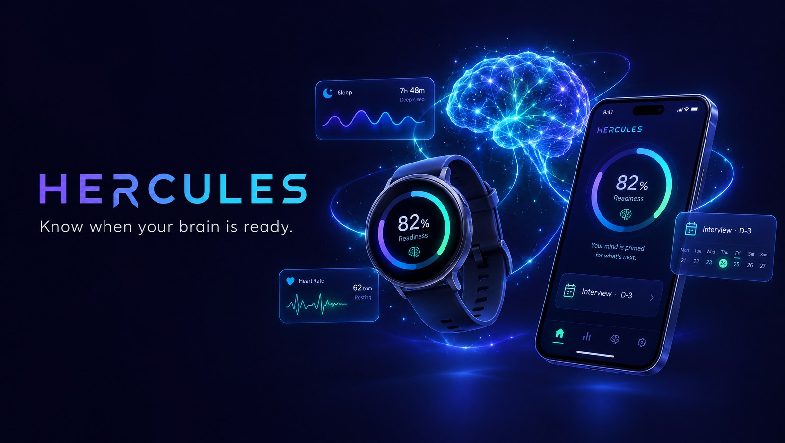

# Hercules

<p align="center"></p>



**Know when your brain is ready.** Hercules turns the body signals your smartwatch already collects (sleep, heart rate, activity) into a daily **cognitive readiness score from 1 to 100%**. It tells you what that means for today's important moments, and it coaches you through the days leading up to them.

Android phone and Wear OS watch today (Kotlin Multiplatform), built so iOS and watchOS can follow with the same core logic.

---

# Part 1: Business process

## 1. The idea

High-stakes moments like a job interview, a negotiation, a pitch or a big decision depend on focus, working memory and emotional control. Those depend heavily on how you slept and how recovered your body is. Most people walk into those moments blind to their own condition.

Hercules answers three questions every day:

| Question | Where in the app |
|---|---|
| *How ready am I today?* | **Today** tab: score, band, best hours |
| *Should I do that important thing today, or move it?* | Event card and **Go / reschedule** advice |
| *How do I arrive at my big day in top shape?* | **Plan** tab: 7-day run-up with a daily checklist |

## 2. Daily flow

```
 Night                  Morning                    During the day                 Evening
 ─────                  ───────                    ──────────────                 ───────
 Watch records sleep →  App computes the score  →  Best-time window guides      → Tips for tonight
 and sleeping HR        + 30-second check-in       when to do important work       (bedtime for the event)
```

1. **Sleep is recorded automatically.** Wear the watch to bed. It detects falling asleep and waking up, and measures your sleeping heart rate.
2. **Morning check-in (optional, 30 seconds).** Tap two 1–5 scales: energy and stress. Sleep is never asked: it always comes from the watch. If the detected times look wrong (or the watch missed the night), tap **Correct** in the Sleep section and set when you fell asleep and woke up. A corrected night is marked "Corrected by you" and automatic detection never overwrites it.
3. **The score appears**, with a band, a one-line meaning, and your **best hours** for demanding work.
4. **Tips** are short headlines; tap one to see the detail.
5. **The watch is kept simple:** today's score and peak hours, what it is tracking (sleep, heart, steps) and whether that data reached the phone, and a readiness forecast ring for each big moment in the next 7 days. Small animations (the bezel sweeping up to the score, a heart beating at your pulse, a breathing moon while calibrating) make it feel alive without extra battery-heavy assets.

## 3. Reading the score

| Score | Band | What it means | What to do |
|---|---|---|---|
| 85–100 | **Prime** | Focus and judgement at their best | Schedule the hardest things today |
| 70–84 | **Good** | Ready for important work | Put it in your peak window |
| 55–69 | **Fair** | You can still perform well, but timing matters | Peak window only, use a checklist, don't decide on impulse |
| 40–54 | **Low** | Risk judgement and impulse control drop | Postpone non-urgent big decisions, get a second opinion |
| 1–39 | **Drained** | Body and brain need recovery | Reschedule if possible, light tasks, sleep early |

**Accuracy.** The score compares you with *your own* normal (14-day personal baseline). During the first 7 days the app shows "Calibrating x/7 days".

## 4. How the score is built

| Ingredient | Weight | Signal | Source |
|---|---|---|---|
| Sleep | 40% | Hours asleep last night (best at 7.5–9 h) | Watch (user can correct the times) |
| Recovery | 30% | Sleeping heart rate (or resting HR) vs. your usual. Higher means strain: stress, alcohol, illness, poor recovery | Watch |
| How you feel | 15% | Energy and stress, each 1–5 | Morning check-in |
| Activity | 15% | Yesterday's steps vs. your usual. Too little and too much both cost readiness | Watch |

If an ingredient is missing (for example no check-in, or the heart-rate sensor is switched off), its weight is spread over the others.

**Time of day.** Alertness follows a daily rhythm anchored to your wake time. The app adjusts the score for any specific hour:

| Phase (hours after waking) | Adjustment |
|---|---|
| Waking up (0–1 h) | −10 |
| **Peak focus (2–5 h)** | **+3** |
| Afternoon dip (6.5–8.5 h) | −8 |
| Second wind (8.5–11.5 h) | 0 |
| Winding down / late | −8 / −18 |

So an interview at 10:00 can score noticeably better than the same interview at 14:00.

## 5. Planning a big moment (up to 7 days ahead)

**Example:** "Job Interview with Google", 6 days from now at 10:00.

1. **Add it** in the Plan tab: title, stakes (normal, important, critical), day (up to 7 days out) and time. No category to pick: the kind of moment (interview, negotiation, pitch, exam, decision) is inferred from the title. The app shows which daily phase that time usually falls in.
2. **Every day until then** you get a short checklist for the current phase:

| Days to go | Phase | Focus | Example tasks |
|---|---|---|---|
| D-7 … D-3 | Build the foundation | Consistent sleep, core material | Sleep/wake at fixed times, prepare 5 STAR stories, limit alcohol |
| D-2 | Sharpen | Realistic rehearsal | Mock interview, no alcohol, skip hard training |
| D-1 | The day before | Protect tonight's sleep | Finish by 20:00, lay out clothes, no caffeine after 14:00, *in bed by 23:15* (calculated from the event time) |
| D | Event day | Activate | Morning light, protein breakfast, *caffeine at 09:15*, brisk walk, box breathing |

Tasks are specific to the kind of moment, inferred from the title. A negotiation gets "define your BATNA" and a presentation gets "timed dress rehearsal".

3. **Progress is visible:**
   - **Prep score** = recent readiness (45%) + sleep consistency (35%) + checklist completion (20%)
   - **Forecast**: expected readiness at the event hour if your current habits continue
   - **Run-up dots**: your daily score for each day from D-7 to D
4. **On the day** the app gives a verdict from your actual readiness *at the event hour*:

| Expected score at event time | Normal importance | Important / Critical |
|---|---|---|
| ≥ 75 | Go ahead | Go ahead |
| 60–74 | Go, with a game plan | Go, with a game plan |
| 45–59 | Go, with a game plan | Consider rescheduling |
| < 45 | Consider rescheduling | Postpone if you can |

It comes with the reasons (for example "Sleep: 5h 10m" or "14:00 falls in your afternoon dip") and concrete actions, such as moving to your peak window, timing caffeine, or for a negotiation, "ask for 24 hours before agreeing to anything big".

## 6. Sensors are your choice

Phone **Data → Sensors** (or watch **Sensors**) lists every background sensor with a switch: heart rate, sleep, steps, 🔥 calories, 📏 distance, 🏢 floors. Each row shows what it feeds (Recovery, Sleep, Activity, Stats) and whether the watch is actually recording it. A change on either device syncs to the other. Turning a sensor off removes its ingredient from the score; it doesn't break the score.

## 7. Important limits

- Hercules is a **heuristic decision aid, not a medical device**. It doesn't diagnose anything.
- Weights and curves come from general sleep and performance research, not from a clinical validation of this app.
- Data stays on your devices. There is no backend yet.

---

# Part 2: Technical

## Architecture

```
┌──────────── Wear OS watch (wear) ───────────┐        ┌────────────── Android phone (mobile) ──────────────┐
│ Health Services passive monitoring          │        │ WatchSyncListenerService                           │
│  HR, steps, calories, distance, floors      │ batch  │  store samples → insights → readiness refresh      │
│  + user activity state (asleep/awake) ──────┼───────►│  → push WatchState back to the watch               │
│ Sync status: "Sent to phone · 2m ago"       │MessageC│ Compose UI: Today · Plan · Data(+Sensors)          │
│ Home: score, tracking, big-moment forecasts │◄───────┤ DataClient: /hercules/state, /hercules/sensors/*   │
│ Sensors screen ◄──── /hercules/sensors ────►│DataCli.│ NoopRemoteSink → (future) HttpRemoteSink → backend │
└──────────────────────┬──────────────────────┘        └──────────────────────────┬─────────────────────────┘
                       └───────────── shared (Kotlin Multiplatform) ──────────────┘
      models · SQLDelight DB · DailyAggregator · records · SleepAnalyzer · ReadinessEngine · PrepCoach
      CognitiveService · SensorConfig · SyncService/WireCodec · DemoData        (Android now, iOS/watchOS next)
```

All scoring and coaching logic is in `shared`, so the watch can compute a score on its own and an iOS/watchOS port reuses it unchanged.

## Modules

| Module | Contents |
|---|---|
| `shared/` | `model/` samples and summaries · `insights/` day keys, daily aggregation, personal records, HRV · `cognitive/` `SleepAnalyzer`, `Baseline`, `ReadinessEngine`, `PrepCoach`, `CognitiveService` + `CognitiveStore` · `sensors/` `SensorKind`, `SensorConfig`, `SensorReport` · `sync/` batch sync + wire format · `demo/` synthetic data · `sqldelight/` schema |
| `wear/` | `health/` passive monitoring, sleep (activity state), sensor settings + listener · `sync/` phone sink, periodic worker, `SyncStatus`, `WatchStateSource` · `ui/` Wear Compose M3 |
| `mobile/` | `sync/` receives watch batches · `HerculesMobileApp` graph (state + sensor push) · `ui/` Today, Plan, event detail, guide, Data/Sensors |

## Sensors and what they're used for

| Sensor | Health Services source | Stored as | Used by |
|---|---|---|---|
| Heart rate | `HEART_RATE_BPM` (passive) | `heart_rate` | Sleeping HR, resting HR → Recovery |
| Sleep | `UserActivityInfo` (`USER_ACTIVITY_ASLEEP / PASSIVE / EXERCISE`) | `activity_state` points (state changes) | `SleepAnalyzer`: main sleep in the window 18:00 the day before → 14:00, at least 60 min, wake-ups merged |
| Steps, calories, distance, floors | passive deltas | interval samples | Activity, daily stats, records |

Only sensors that are **enabled** (`SensorConfig`) and **supported** by the watch are registered. The watch publishes a `SensorReport` (supported + active) so the phone shows the real state.

## Data and sync

- **Storage:** SQLDelight (`HerculesDatabase`). Tables: `sample`, `workout_session`, `daily_summary`, `personal_record`, `sleep_night`, `checkin`, `readiness_day` (JSON), `plan_event`, `prep_task_done`.
- **Watch → phone:** every 15 minutes (WorkManager) and while the app is open. Batches go over `MessageClient` on `/hercules/sync/v1`. The phone acks the stored IDs, and only acked rows are marked synced. Sample IDs are deterministic, so retries are idempotent.
- **Phone → watch:** after each batch the phone recomputes readiness and writes `WatchState` (score + next event) to DataClient `/hercules/state`. The watch uses it when it is less than 6 hours old and from today; otherwise it computes locally.
- **Sensor choice:** `/hercules/sensors/config`, written by either side; the newest `updatedMs` wins. The watch reports back on `/hercules/sensors/report`.
- **Backend (future):** the phone keeps everything queued (`synced = 0`). Swap `NoopRemoteSink` for an HTTP sink and set `SERVER_SYNC_ENABLED`. The wire contract is in `docs/contracts/sample-batch.v1.schema.json`.

## Build and test

Requirements: JDK 17+ (21 tested) and the Android SDK (compileSdk 36).

```bash
./gradlew :shared:testDebugUnitTest                  # unit tests: aggregation, sync, sleep, readiness, prep coach, sensors, DB
./gradlew :wear:assembleDebug :mobile:assembleDebug
./gradlew :wear:lintDebug :mobile:lintDebug
```

## Run

```bash
# Phone
adb -s <phone> install -r mobile/build/outputs/apk/debug/mobile-debug.apk
# Galaxy Watch: Developer options → ADB + Wireless debugging
adb connect <watch-ip>:<port>
adb -s <watch> install -r wear/build/outputs/apk/debug/wear-debug.apk
```

Both apps share the `applicationId` `com.hercules.app`, which the Wearable Data Layer requires.

**Try it without a watch (debug builds only):** load 14 days of synthetic sleep, HR and steps plus two sample events ("Job Interview with Google" in 6 days and "Pitching to Y Combinator" later today):

```bash
adb shell am start -n com.hercules.app/com.hercules.mobile.ui.MainActivity --ez demo true
```

You can also use **Data → Developer → Load 14 days of demo data**.

The watch has the same switch, so its UI can be checked on an unpaired Wear OS emulator (grant the sensor permissions first, or tap Allow):

```bash
adb -s <watch-serial> shell am start -n com.hercules.app/com.hercules.wear.ui.MainActivity --ez demo true
```

Right after midnight the score shows "calibrating" until last night's sleep exists. That is expected; set the emulator clock to the morning to see a score.

**Synthetic sensors on a Wear emulator:**

```bash
adb -s <watch> shell am broadcast -a "whs.USE_SYNTHETIC_PROVIDERS" com.google.android.wearable.healthservices
adb -s <watch> shell am broadcast -a "whs.synthetic.user.START_WALKING" com.google.android.wearable.healthservices
```

Logs: `adb logcat -s Hercules HerculesSync HerculesState HerculesPhoneSync`.

## Porting to iOS / watchOS

1. Install Xcode, then build the framework: `./gradlew -Phercules.apple=true :shared:linkDebugFrameworkWatchosSimulatorArm64` (targets `iosArm64`, `iosSimulatorArm64`, `watchosArm64`, `watchosSimulatorArm64`; framework `HerculesShared`).
2. **watchOS (SwiftUI):** feed HealthKit into `HerculesRepository.insertSamples`. Map `HKCategoryTypeIdentifier.sleepAnalysis` to `activity_state` samples, so `SleepAnalyzer` works as-is. Show `CognitiveService.watchState()`.
3. **iOS (SwiftUI or Compose Multiplatform):** WatchConnectivity replaces the Data Layer. Reuse `CognitiveService`, `PrepCoach` and `SyncService`.
4. Consider SKIE so `suspend` and `Flow` look like Swift `async` and `AsyncSequence`.

## Design

The UI is designed as a **precision instrument**, not a wellness toy: matte black (`#05050E`), electric cyan (`#3FE0FF`) and indigo (`#6E6BFF`), hairline rules instead of card stacks, sharp 6 dp corners, small letter-spaced section labels, monospace readouts, and Material *Rounded* line icons (no emoji).

| Element | Where |
|---|---|
| Bezel dial: 100 ticks lit up to the score | Phone Today hero; watch home (follows the round screen edge) |
| Day strip: last night's sleep, focus windows, *now*, today's events on one time axis | Phone Today |
| Countdown rail: events as stops on a vertical line | Phone Plan |
| Sensor tiles: lit = recording | Phone Data |

**User journeys and illustrations** (generated with Higgsfield, GPT Image 2.5, in one blueprint style; `mobile/src/main/res/drawable-nodpi/ill_*.webp`):

| Journey moment | Illustration |
|---|---|
| Onboarding 1: "Your brain has a readiness level" | `ill_score`: head profile inside a precision dial |
| Onboarding 2: "Sleep sets the dial", and Today with no reading yet | `ill_sleep`: sleep wave flowing into a watch |
| Onboarding 3: "Aim for the big day", and empty Plan | `ill_plan`: seven ascending platforms to a diamond |
| Check-in logged | `ill_checkin`: rings aligning, calibration done |
| Event day: go | `ill_go`: a doorway of light |
| Event day: postpone | `ill_wait`: hourglass and calendar |
| Watch not connected | `ill_no_watch`: broken signal arc |

**Launch.** The system splash (Android 12+ API, backported) shows the mark on the brand black. On a cold start it hands off to an **animated splash**: Kling 3.0 via Higgsfield, converted to an animated WebP in `res/raw/splash_anim.webp` and played with `AnimatedImageDrawable`. Tap to skip.

| Asset | |
|---|---|
| `docs/images/hercules-icon.png` | Icon master (1024 px): **H** monogram, heartbeat crossbar, readiness gauge. Launcher, adaptive, round and monochrome icons in `mobile/` and `wear/` are generated from it |
| `docs/images/hercules-splash.jpg` | Static splash artwork |
| `docs/images/hercules-hero.jpg` | README / store hero (devices are concept art, not exact app screens) |

## Known gaps

- **Not yet verified on a physical Galaxy Watch.** Verified so far: compiled, unit-tested, lint-clean, and the phone UI was run on an Android emulator with demo data. Watch sleep detection, the phone↔watch state and sensor sync are untested on hardware.
- Sleep stages (deep/REM) and HRV need the Samsung Health Sensor SDK (partner approval). `Hrv.rmssd` is ready for it.
- Score weights are heuristic and not personalised beyond the 14-day baseline.
- No backend or login yet; no notifications or reminders for checklist items yet.
- Events are limited to 7 days ahead and are not linked to the device calendar.
